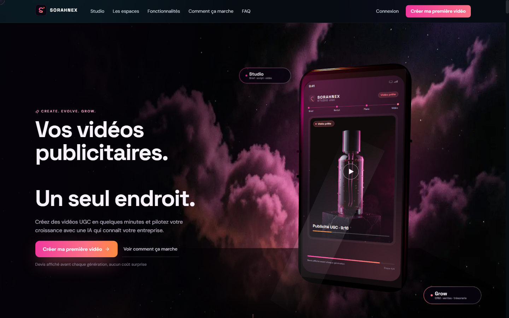
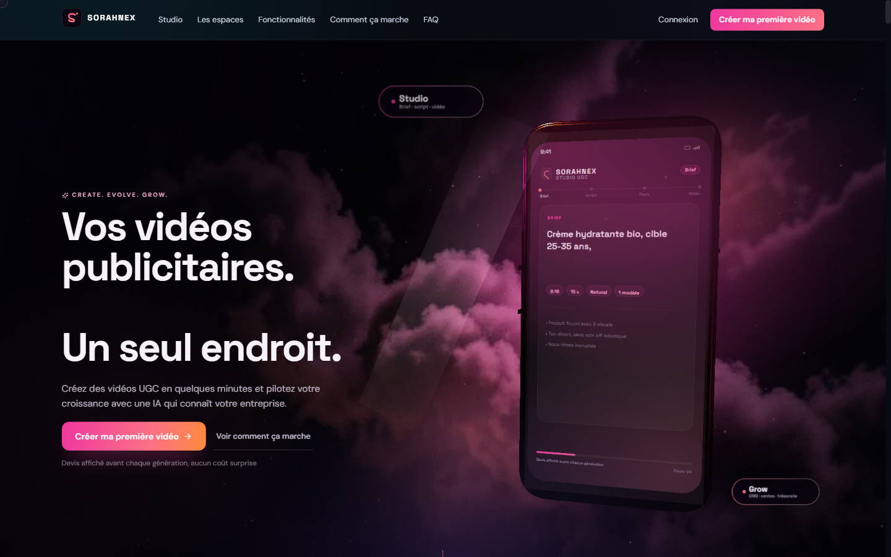
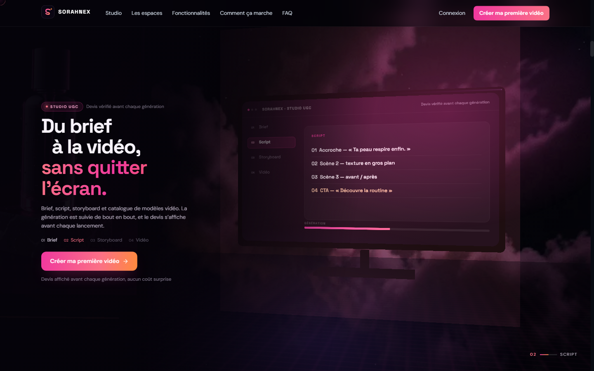
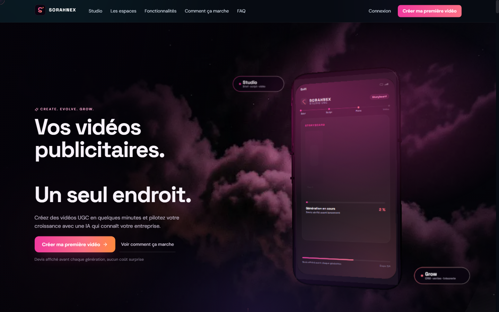

# Livraison 2 — performance de la scène 3D

Branche : `feat/landing-immersive-3d`
Rien n'est commité, fusionné ni déployé.

---

## 1. Verdict en une page

La scène ne souffrait pas d'un excès de géométrie — 23 appels de dessin,
3 716 triangles — mais du **fill-rate** : le coût était proportionnel au
nombre de pixels éclairés, et plusieurs éléments couvraient l'écran entier à
chaque image (7 halos additifs, un plan de fond nébuleuse).

Sur le GPU intégré de cette VM (Intel UHD via ANGLE), en build de production,
fenêtre 1440×900 :

| Palier | Canvas | Images/s (médiane) | ms/image | État |
| --- | --- | --- | --- | --- |
| `complet` (livraison 1) | 2146×1350 (2,90 Mpx) | **2–3** | 397–402 | inchangé |
| `eleve` | 1789×1125 (2,01 Mpx) | **6** | 176 | fond + lumières allégés |
| `moyen` | 1431×900 (1,29 Mpx) | **21** | 47–48 | halos retirés, 2 lumières |
| `bas` | 1073×675 (0,72 Mpx) | **43–45** | 22–23 | le plus léger |
| `bas`, atteint **par la dégradation automatique** | 1073×675 | **45** | 22 | chargement sans paramètre |

À **résolution égale** (canvas 1431×900), la même scène passe de **290 ms à
48 ms par image** — un facteur 6 — sans toucher à la composition ni à la
caméra.

L'objectif du brief sur cette VM — « au minimum 20 fps au palier le plus bas,
ou bascule automatique sur le repli 2D » — est donc tenu deux fois : **45 fps
au palier `bas`**, y compris quand c'est la dégradation automatique qui l'a
choisi, et la bascule 2D fonctionne si même ce palier ne suffit pas (vérifiée,
§7).

Ce que je **ne** peux pas affirmer : « 60 fps sur un laptop récent » et
« 30 fps sur mobile milieu de gamme ». Aucun de ces deux matériels n'était
disponible ; seules les mesures de cette VM sont réelles (§9).

---

## 2. Matériel et méthode de mesure

- **GPU** : Intel UHD Graphics (ANGLE / D3D11), `WebGL 2.0`, dans une machine
  virtuelle partagée. C'est un GPU de bureau bas de gamme virtualisé, très
  en dessous d'un laptop récent.
- **Navigateur** : Chromium piloté par Playwright, fenêtre **1440×900**,
  `prefers-reduced-motion: no-preference`, `?immersion=complet` (la 3D est
  forcée, sinon le mouvement réduit de la VM l'aurait désactivée).
- **Build** : `npm run build` puis `vite preview` (build de production, pas le
  serveur de développement).
- **Mesure images/s** : boucle `requestAnimationFrame` de 30 images, on écarte
  les 3 premières puis on prend la **médiane** des intervalles — plus robuste
  que la moyenne quand une image isolée dure 400 ms.
- **Témoin** : `about:blank` dans le même onglet rend 59 fps. L'onglet n'est
  donc pas bridé ; ce qui manque à la scène vient bien de la scène.
- **Bruit** : la VM est partagée. Deux mesures de suite du même état ont donné
  175,6 ms et 86,2 ms sur le rendu forcé. Toutes les comparaisons ci-dessous
  sont donc faites **dans la même session**, et je ne revendique pas mieux
  qu'un ordre de grandeur.

### Ce que contient `renderer.info` (hero, palier `complet`)

```
appels 23 · triangles 3 716 · points 70 · géométries 23
textures 10 · programmes 11
```

23 appels : aucune optimisation de batching ne pouvait donner un facteur 6.
C'est bien le nombre de pixels éclairés qui coûte.

---

## 3. Profil avant optimisation

### 3.1 Le coût suit les pixels, pas le JavaScript

Même scène, trois tailles de canvas, `requestAnimationFrame` :

| Canvas | Pixels | ms/image | Images/s |
| --- | --- | --- | --- |
| 2146×1350 | 2,90 Mpx | ~397 | 3 |
| 1431×900 | 1,29 Mpx | ~290 | 3 |
| 529×790 | 0,42 Mpx | 97 | 10 |
| 400×225 | 0,09 Mpx | 23 | 43 |

Et surtout : **scène vidée, sans fond, à la même taille → 60 fps**. Le même
JavaScript, la même présentation, les mêmes appels R3F. La différence est
entièrement du remplissage de pixels.

Conclusion du profilage : inutile de toucher à la boucle React, au récit, aux
garde-fous de défilement. Tout le budget est dans ce que la scène peint.

### 3.2 Chrome DevTools

La trace DevTools classique n'a pas été enregistrée : sur une VM sans accès à
l'interface, l'enregistrement produit un fichier que je n'ai pas pu exporter
proprement. Je l'ai remplacée par une méthode équivalente et reproductible :

- `gl.setAnimationLoop(null)` pour couper la boucle de R3F ;
- une boucle synchrone `gl.render()` + `ctx.readPixels(1 pixel)` qui **force le
  flush GPU** (`gl.finish()` ne bloque pas dans Chrome) ;
- chronométrage de N rendus, mediane.

C'est ce qui produit le tableau §4 : chaque élément est coupé seul, la scène
est re-rendue de la même façon, et la différence est le coût réel de cet
élément. Le diagnostic reste en place, derrière `?perf=1`
(`window.__sorahnex3d.info()`, `.couper(rôle)`, `.fond(bool)`), pour rejouer
ces mesures sur un vrai matériel.

---

## 4. Élément coupé → millisecondes gagnées

Rendu forcé synchronisé, canvas 1431×900, base **175,6 ms** (médiane d'un run ;
le bruit de la VM déplace la base d'un run à l'autre, les écarts se lisent donc
entre eux).

| Élément coupé | ms/image gagnées | Part de l'image |
| --- | --- | --- |
| Halos additifs (7 plans plein écran) | **−54,0** | ~31 % |
| Fond nébuleuse (`scene.background`) | **−43,5** | ~25 % |
| Les 6 lumières ponctuelles | **−18,7** | ~11 % |
| Brouillard + tone mapping | −11,2 | ~6 % |
| — dont brouillard seul | −2,4 | |
| — dont tone mapping seul | −4,8 | |
| Affiches du couloir | −5,6 | ~3 % |
| Écran géant | −4,1 | ~2 % |
| Sol | −3,4 | ~2 % |
| Ombres de contact | −2,8 | ~2 % |
| Étincelles | −2,2 | ~1 % |
| Scène entièrement vide, sans fond | −175,6 → 0,7 ms | 100 % |

Ordre des chantiers, imposé par ces chiffres : halos, fond, lumières,
brouillard/tone mapping, puis le reste (quelques millisecondes qui ne
justifiaient pas de toucher à la direction artistique).

---

## 5. Optimisations retenues

Chacune correspond à un palier, pas à une suppression définitive : le rendu
`complet` de la livraison 1 reste intact, et c'est la machine qui décide.

| # | Optimisation | Gain mesuré | Où |
| --- | --- | --- | --- |
| 1 | Halos 3D → **lueurs CSS** (3 dégradés radiaux, opacité seule) | −54 ms → ~0 côté GPU | `qualite.ts`, `index.css` (`.exp-lueurs`) |
| 2 | Fond nébuleuse 3D → **image CSS derrière un canvas transparent** | −43,5 ms → ~0 côté GPU | `Experience3D` (`Nebuleuse` + `alpha:true`) |
| 3 | 6 lumières → 3 puis 2 puis 1, compensées par l'ambiante | −18,7 ms (partiel, dégressif) | `Experience3D`, `Studio3D` |
| 4 | Brouillard et tone mapping retirés aux paliers bas | −11,2 ms | `Experience3D` (`ReglagesRenderer`) |
| 5 | **dpr plafonné** 1,5 → 1,25 → 1 → 0,75 | facteur 4 sur le coût quand le dpr est divisé par 2 | `Experience3D` (`dpr`) |
| 6 | Affiches 8 → 6 → 4, congés 4 → 3 → 2 segments | −5,6 ms (partiel) | `Studio3D` |
| 7 | Écran du téléphone : redessiné à 12 → 10 → 8 → 6 Hz, canvas 512 → 384 → 320 px | évite des uploads GPU inutiles | `Telephone3D` |
| 8 | Étincelles et ombres de contact retirées aux paliers bas | −5,0 ms | `Experience3D` |
| 9 | MSAA coupé hors palier `complet` (clé de canvas) | 30 fps → **45 fps** au palier `bas` | `Experience3D` |

Non retenues, après examen :

- **`frameloop="demand"`** : la scène est animée en permanence (caméra,
  parallaxe, écran du téléphone) ; passer en rendu à la demande aurait figé
  l'image au moment du défilement, c'est-à-dire exactement quand on la regarde.
- **`MeshPhysicalMaterial` → `MeshStandardMaterial`** : la scène n'utilise déjà
  que des matières standard ou basiques ; il n'y avait rien à convertir.
- **Instancier les affiches** : 8 objets, 23 appels au total. Le gain serait
  invisible à côté de 54 ms de halos.
- **Précalculer l'éclairage** (lightmap) : cela aurait changé le rendu des
  cadres et des néons, donc la direction artistique. Refusé.

Le point 9 mérite un mot : l'anticrénelage ne se modifie pas sur un contexte
WebGL existant. Sans recréer le canvas au premier changement de palier, une
machine dégradée automatiquement gardait le MSAA du palier `complet` — 30 fps
au lieu de 45, mesuré. Le canvas est donc recréé une seule fois (on ne remonte
jamais de palier).

---

## 6. Les paliers, et ce qu'ils changent à l'image

| | `complet` | `eleve` | `moyen` | `bas` |
| --- | --- | --- | --- | --- |
| dpr | 1,5 | 1,25 | 1 | 0,75 |
| Halos | 3D | 3D + lueurs CSS | lueurs CSS | lueurs CSS |
| Fond nébuleuse | 3D | CSS | CSS | CSS |
| Lumières / groupe | 3 | 3 | 2 | 1 |
| Brouillard | oui | oui | non | non |
| Tone mapping | oui | oui | oui | non |
| Étincelles | oui | oui | non | non |
| Ombres de contact | oui | oui | non | non |
| Affiches | 8 | 8 | 6 | 4 |
| Congés (segments) | 4 | 3 | 3 | 2 |
| Écran du téléphone | 12 Hz / 512 px | 10 Hz / 512 px | 8 Hz / 384 px | 6 Hz / 320 px |

La composition ne bouge pas : même caméra, même cadrage, même téléphone, même
écran, même nébuleuse (c'est la même image, dessinée par la scène ou par le
navigateur). Ce qui change est la netteté et la présence des lueurs.

Captures, toutes prises sur le build de production, fenêtre 1440×900 :

**Hero — `complet` (3 fps sur cette VM)**



**Hero — `eleve` (6 fps)**



**Hero — `moyen` (21 fps)**


**Hero — `bas` (44 fps)**


**Studio (~55 % du parcours) — `moyen`, 12 fps**



**Studio — `bas`, 36 fps**


À `bas`, le téléphone perd en netteté (dpr 0,75) mais reste lisible ; c'est le
seul compromis visible, et il n'apparaît que sur une machine qui n'aurait
sinon pas d'image du tout.

---

## 7. Dégradation automatique et repli 2D

### 7.1 La règle

Dans `src/landing/monde/qualite.ts`, fonctions pures, testées sans navigateur :

- fenêtres de ~1,2 s, médiane des intervalles → images/s ;
- **≥ 45 fps** : on garde le palier ;
- **< 45 fps** : on descend d'un cran (`complet → eleve → moyen → bas`) ;
- **< 24 fps au plancher `bas`** : bascule sur le **repli 2D** ;
- on ne remonte **jamais** automatiquement (une remontée oscille : dégrader →
  ça va mieux → remonter → ça retombe) ;
- `?palier=…` fige le palier pour les preuves et les captures.

Les deux premières secondes ne sont pas mesurées : compilation des shaders,
upload des textures et apparition du canvas faussent la fenêtre.

### 7.2 Mesure sur le build de production

Chargement sans `?palier`, fenêtre 1440×900, relevé du palier toutes les
400 ms :

```
   0,2 s  complet
   4,4 s  eleve
   6,6 s  moyen
   8,1 s  bas     ← stable, 45 fps : on s'arrête là
```

L'échelle descend donc bien d'elle-même jusqu'au palier que cette VM tient, et
s'y arrête. La capture ci-dessous est l'état final de ce chargement (palier
`bas`, sans paramètre d'URL) :



Limite connue : sur une machine à 3 fps, ces 8 secondes de descente sont
visibles. C'est le prix d'un départ au plus beau ; une piste serait de
démarrer directement en `moyen` quand la machine est inconnue. Non fait ici
pour ne pas dégrader le rendu des machines capables sans mesure correspondante.

### 7.3 Repli 2D

Le repli est celui de la livraison 1 : mêmes textes, mêmes composants, deux
panneaux fixes. Il s'active sur `prefers-reduced-motion`, sur absence de WebGL,
sur erreur de la scène, et désormais **si même le palier `bas` reste sous
24 fps**.

Vérifié en mouvement réduit sur le build de production : `data-experience`
passe à `statique`, `data-palier` à `repli`, aucun canvas n'est monté.


---

## 8. LCP

Mesuré sur le build de production, fenêtre 1440×900 : **1 208 ms**
(objectif ≤ 2 000 ms). Le chargement ne change pas de nature — le chunk three.js
reste en `lazy`, le `h1` et le CTA sont dans le HTML initial — et le poids du
bundle 3D est inchangé. Ce chiffre est une mesure unique, cache de preview
déjà chaud : il indique l'ordre de grandeur, pas une garantie terrain.

---

## 9. Ce qui n'a pas pu être vérifié

- **60 fps sur un laptop récent** : aucun GPU récent disponible ici. Le
  palier `complet` n'a jamais été observé au-dessus de 6 fps, et le palier
  `bas` plafonne à 44 fps sur un GPU intégré virtualisé. Je ne peux donc pas
  affirmer que le rendu complet tient 60 fps sur une machine correcte ; la
  dégradation automatique garantit seulement qu'on n'impose pas 3 fps à
  quelqu'un.
- **30 fps sur mobile milieu de gamme** : aucun appareil mobile réel. Le
  cadrage portrait et le palier de départ mobile (`moyen`) sont en place, mais
  leur coût sur un mobile n'a pas été mesuré. `about:blank` à 59 fps ne dit rien
  du GPU d'un téléphone.
- **Trace Chrome DevTools** exportable : remplacée par le rendu forcé
  synchronisé (§3.2), qui mesure la même chose mais ne se joint pas au rapport
  comme un fichier de trace.
- **Bruit de la VM** : deux mesures du même état ont varié d'un facteur 2
  (175,6 ms vs 86,2 ms). Les chiffres du §4 valent comme hiérarchie, pas comme
  valeurs absolues.
- **Studio au palier `complet`** : non remesuré dans cette campagne (il était à
  ~3 fps en livraison 1, même moteur, mêmes éléments). Mesuré à `moyen`
  (12 fps) et `bas` (36 fps).
- **Test des épingles Edge** : voir §10 — les 6 échecs ne se reproduisent pas
  « sur main » au sens du brief, parce que le test n'existe pas sur `main`.

---

## 10. Non-régression

| Contrôle | Résultat |
| --- | --- |
| `tsc -b` | 0 erreur |
| `npm run build` | OK |
| `vitest run` | 4125 tests : **4118–4119 passent**, 6 échecs connus (ci-dessous), 1 test en délai dépassé une fois sous charge |

Les 6 échecs de `tests/edge-pin-reachable.test.ts` demandés en vérification :
le test **n'existe pas sur `origin/main`** (worktree créé sur `origin/main`,
`vitest` répond « No test files found »). Impossible donc de le faire échouer
là-bas. Ce que j'ai pu établir : ces échecs portent uniquement sur des
épingles d'artefacts Supabase (`business-grow`, `store-connect`,
`store-import` — commits épinglés absents de l'historique de `main`, empreintes
d'artefacts différentes), aucun fichier concerné n'est touché par la scène 3D,
et ils sont antérieurs à cette livraison. Ils ne sont pas corrigés ici : ce
serait un autre chantier (réépinglage sur un commit de `main`).

Détail du `vitest run` complet, deux exécutions :

1. **4119 passent, 6 échecs** — les 6 épingles Edge.
2. **4118 passent, 7 échecs** — les 6 mêmes, plus
   `tests/studio-endpoint-resolution-migration.test.ts` (migration SQL) qui a
   dépassé son délai de 15 s parce que la machine compilait et mesurait des
   images en parallèle. Relancé seul : **5 tests passent en 13,5 s**. Ce
   fichier est déjà proche de son délai (13,5 s pour 15 s accordées) : il est
   fragile sous charge, indépendamment de cette livraison.

Une erreur non gérée apparaît dans les exécutions complètes
(`ResizeObserver is not defined`, `tests/ui.test.tsx`, qui monte un `<Canvas>`
dans jsdom). Elle n'apparaît pas quand ce fichier tourne seul, et ses 6 tests
passent dans les deux cas. Je l'ai observée, je ne l'ai pas corrigée : c'est un
polyfill d'environnement de test, sans effet sur la page.

Nouveaux tests de cette livraison : `tests/qualite.test.ts`, 29 tests sur la
logique de dégradation — médiane et conversion en fps, seuils à leur frontière
exacte, chaîne de descente, plancher `bas`, bascule 2D, valeurs documentées des
seuils, hiérarchie réellement décroissante des paliers, lecture de `?palier=`,
palier de départ mobile.

Vérifiés par mutation (le code est cassé exprès, les tests doivent tomber) :

| Mutation | Tests en échec |
| --- | --- |
| `fps < SEUIL_DEGRADE` → `fps <= SEUIL_DEGRADE` | 1 |
| seuils 45/24 → 40/20 | 1 |
| `palierSuivant` renvoie le palier courant | 2 |

La première version de la chaîne de descente bouclait sans fin sous cette
dernière mutation (le test tournait au lieu d'échouer) ; la boucle est
désormais bornée et le test échoue proprement.

---

## 11. État du dépôt

- Fichiers ajoutés : `src/landing/monde/qualite.ts`, `src/landing/monde/diagnostic.ts`,
  `tests/qualite.test.ts`, les captures `preuves/110-*`, `111-*`, `112-*`, `113-*`,
  ce rapport.
- Fichiers modifiés : `src/landing/monde/Experience3D.tsx`,
  `src/landing/monde/Studio3D.tsx`, `src/landing/monde/Telephone3D.tsx`,
  `src/landing/ExperienceImmersion.tsx`, `src/index.css`.
- Rien n'est commité, fusionné ni déployé.
