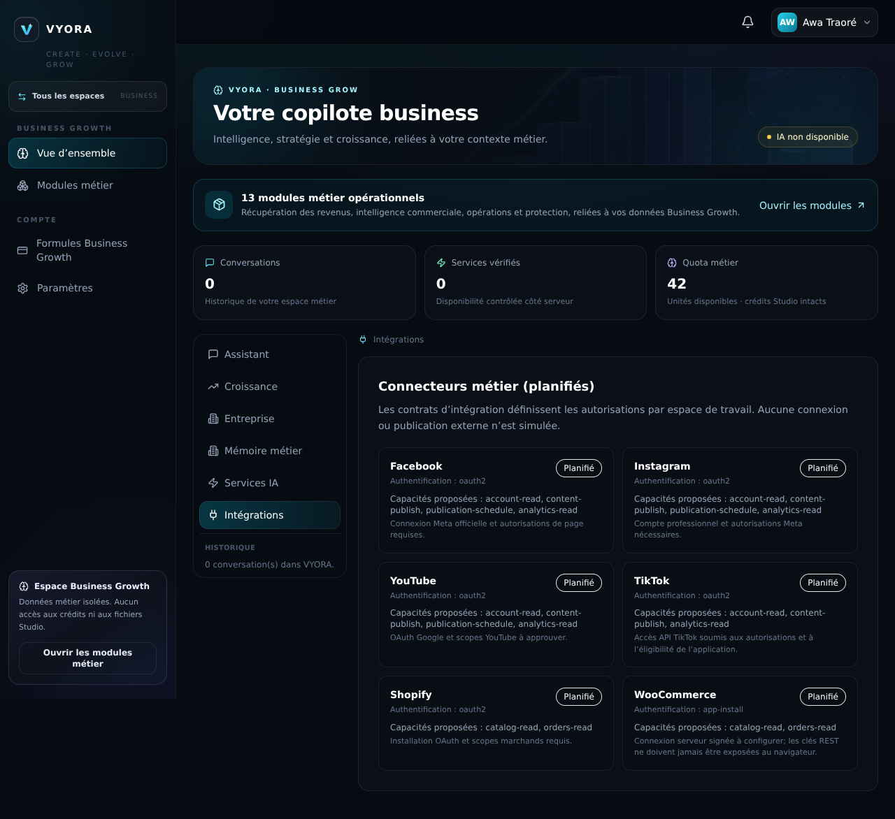
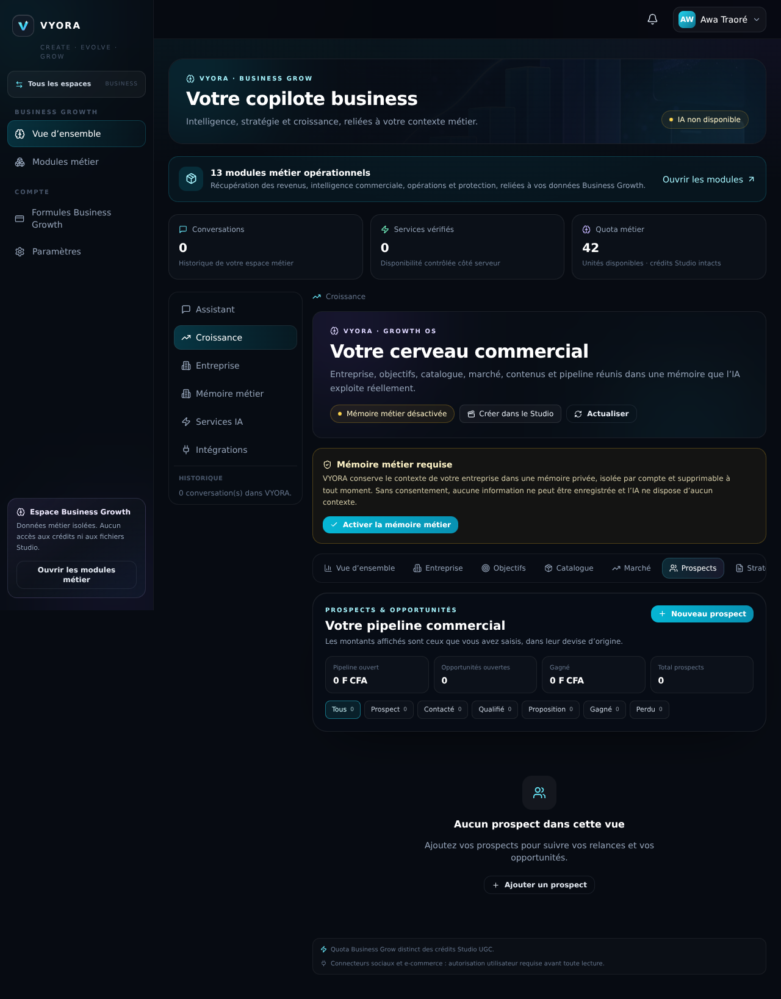
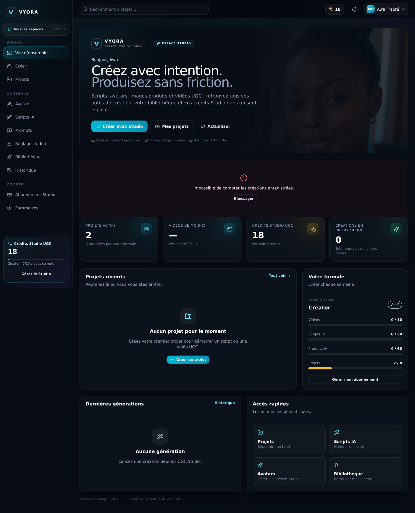
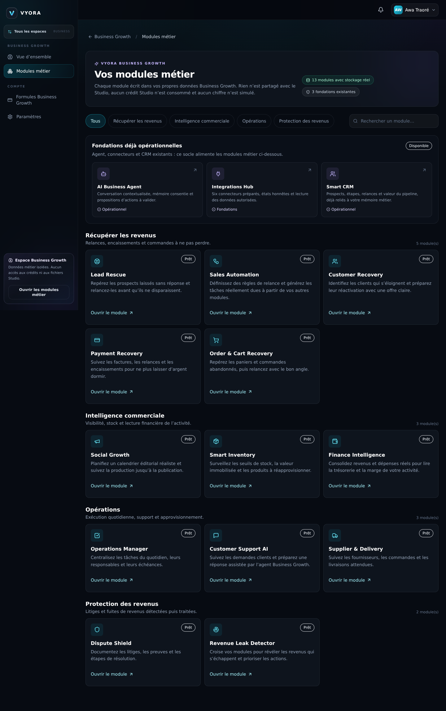
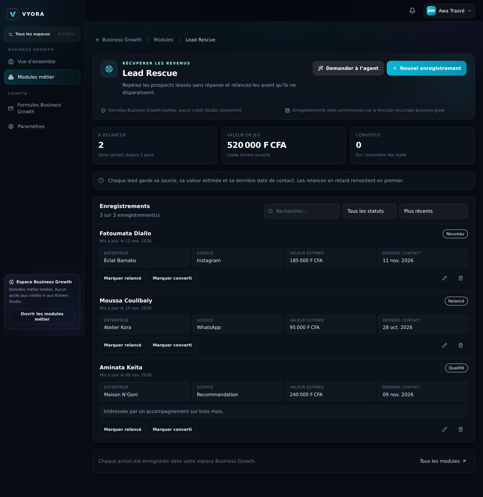
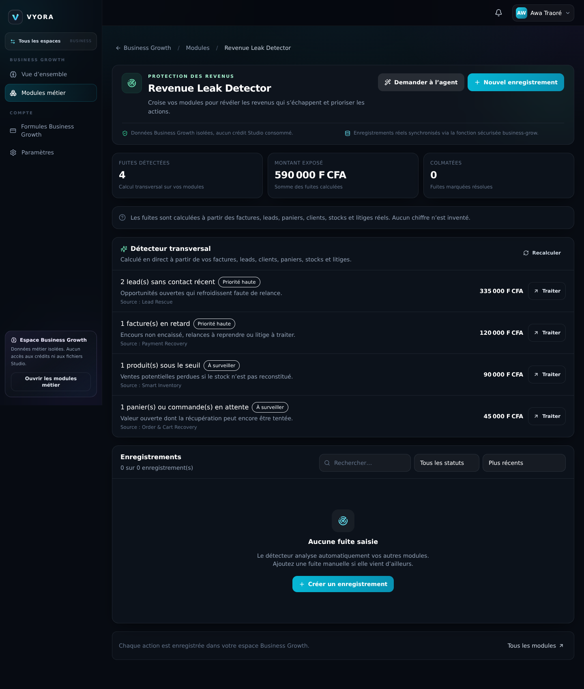

# Rapport de livraison — Hub post-connexion & modules Business Growth

**Branche :** `arena/ada94e4c-saas-ugc`  
**Base :** `5b6bc240a7a9f9ba7f316b0e5565ba207c7ef7ea`  
**Date de vérification :** 13 novembre 2026  
**Périmètre :** expérience post-connexion `/app`, séparation Studio / Business Growth, 13 modules métier persistés et 3 modules de fondation.

> Aucun commit, aucun push, aucun merge de `main`, aucun déploiement Netlify ni Supabase n’a été effectué.


---

## 1. Parcours post-connexion

### Routes livrées

| Route | Écran | Rôle |
|---|---|---|
| `/app` | `Home` | Hub de choix entre les deux espaces |
| `/app/studio/accueil` | `Dashboard` | Accueil **strictement Studio** |
| `/app/studio` | `GenerationStudio` | Outil de génération Studio |
| `/app/business` | `BusinessGrowWorkspace` | Espace Business Growth |
| `/app/business?section=…` | Workspace | Ouvre directement une section |
| `/app/business?section=growth&growthTab=…` | Workspace | Ouvre directement un onglet Croissance |
| `/app/business/modules` | Catalogue | Les 13 outils, classés par finalité |
| `/app/business/modules/:moduleKey` | Workspace de module | CRUD réel et KPI calculés |

### Ce que fait le hub

- Salutation issue du profil authentifié (`Bonjour, Awa.`), avec repli neutre si le prénom manque.
- Deux cartes d’espace indépendantes, sans tarif Business Growth et sans redirection d’abonnement :
  - **VYORA Studio** → `/app/studio/accueil` ;
  - **VYORA Business Growth** → `/app/business`.
- Bandeau de garanties : crédits séparés, données isolées, retour possible au sélecteur.
- Nav du hub sans les entrées Studio/Business ; la sidebar de chaque espace conserve **« Tous les espaces »**.
- Le libellé de marque de la sidebar est revenu à une seule source (`BrandLockup`) et ne s’affiche plus sur deux lignes.

### Deep links vérifiés

- `/app/business?section=integrations` → **« Connecteurs métier (planifiés) »**.
- `/app/business?section=growth&growthTab=crm` → **« Prospects & opportunités »** (Smart CRM).
- Les valeurs sont validées par listes blanches : section parmi `chat | growth | company | memory | providers | integrations`, onglet parmi les 9 onglets Croissance. Une valeur inconnue retombe sur l’état normal, sans erreur.
- Le module de fondation Smart CRM pointe désormais vers `?section=growth&growthTab=crm`.




### Séparation des espaces

- `Dashboard` a été réécrit en accueil Studio : projets, crédits, formule, générations, accès rapides Studio. Aucune mention, aucun CTA, aucun chiffre Business Growth.
- Les crédits et le portefeuille Studio ne sont jamais lus ni débités par les modules métier. La carte du hub l’annonce explicitement : **« Aucun accès aux crédits Studio »**.
- Les données métier vivent dans `saas_business`, avec RLS forcée et fonctions `SECURITY DEFINER` ; aucune lecture directe des tables.



---

## 2. Les 13 modules métier

Chaque module possède une page dédiée, un stockage réel, des champs validés, des statuts, des KPI recalculés à partir des enregistrements, des actions rapides et la possibilité de demander une analyse à l’agent avec le contexte réel du module.

| # | Module | Groupe | Ce que l’utilisateur saisit | Ce qui est réellement calculé / exécuté |
|---|---|---|---|---|
| 1 | **Lead Rescue** | Revenus | Prospect, entreprise, source, valeur estimée, dernier contact, prochaine action | Leads ouverts, valeur en jeu, relances en retard ; actions « Marquer relancé / converti » |
| 2 | **Sales Automation** | Revenus | Règles : déclencheur, action, délai, statut | Génération déterministe des tâches dues dans Operations Manager, sans doublon, plafonnée à 25 par exécution |
| 3 | **Customer Recovery** | Revenus | Client, contact, valeur historique, dernière commande, offre | Clients à risque, valeur historique, statut de réactivation |
| 4 | **Payment Recovery** | Revenus | Référence, client, montant, échéance, niveau de relance | Encours, factures échues, retard en jours ; aucune relance externe simulée |
| 5 | **Order & Cart Recovery** | Revenus | Référence, client, valeur, date d’abandon, canal | Valeur ouverte, paniers à relancer, récupérations constatées |
| 6 | **Social Growth** | Intelligence | Titre, canal, format, date planifiée, statut de production | Calendrier réel, contenus à produire / publiés ; **aucune publication automatique** |
| 7 | **Smart Inventory** | Intelligence | SKU, produit, stock, seuil, prix, coût unitaire | Valeur du stock, produits sous seuil, marge potentielle |
| 8 | **Finance Intelligence** | Intelligence | Libellé, nature revenu/dépense, montant, date | Revenus, dépenses, trésorerie et marge recalculés |
| 9 | **Operations Manager** | Opérations | Tâche, responsable, échéance, priorité, source | Tâches ouvertes/en retard, y compris celles créées par Sales Automation |
| 10 | **Customer Support AI** | Opérations | Objet, client, canal, priorité, message, brouillon | Tickets ouverts ; bouton « Préparer avec l’agent » qui ouvre l’agent avec le message réel |
| 11 | **Supplier & Delivery** | Opérations | Fournisseur, référence, livraison attendue, montant, statut | Commandes en transit, livraisons en retard, montant engagé |
| 12 | **Dispute Shield** | Protection | Référence, partie, montant, date, motif, preuves | Litiges ouverts, montant en jeu, étapes de résolution |
| 13 | **Revenue Leak Detector** | Protection | Fuites identifiées manuellement + lecture des autres modules | Croisement factures / leads / paniers / clients / stocks / litiges ; montant et sévérité calculés, aucun chiffre inventé |

### Détails d’usage

- **Création / édition / suppression** avec confirmation, validation des champs requis, valeurs numériques positives (clamp à 0), dates, selects et notes.
- **Recherche, filtre par statut, tri** (récent, montant, date) et pagination par 20.
- **Actions rapides** propres au module (ex. « Marquer relancé », « Encaisser », « Livrer »), qui enregistrent un patch réel.
- **KPI et fuites** calculés côté client à partir des enregistrements chargés depuis le serveur, jamais d’un tableau de démonstration.
- **Catalogue** : 13 outils groupés en 4 finalités + 3 fondations, avec un lien réel par module.





### Les 3 fondations

| Module | État | Ce qui est réel | Limite assumée |
|---|---|---|---|
| **AI Business Agent** | Opérationnel si un fournisseur est vérifié | Conversations persistées, mémoire consentie, routage, quota métier, outils, contexte projet | Sans fournisseur vérifié, l’interface annonce « IA non disponible » et ne génère aucune fausse réponse |
| **Integrations Hub** | Fondations | Six contrats de connecteurs, autorisations, capacités proposées, états relus depuis `integration_connections` | **Aucun OAuth ni publication externe** : les connecteurs restent marqués « Planifié » |
| **Smart CRM** | Opérationnel | Prospects, étapes, relances, valeur du pipeline dans l’onglet Croissance, reliés à la mémoire métier | Aucune synchronisation CRM externe |

---

## 3. Architecture et sécurité

### Front

- `src/business/modules/registry.ts` : définitions déclaratives (champs, statuts, KPI, actions rapides), helpers de calcul, `computeRevenueLeaks`, `buildAutomationTasks`, contextes agent.
- `src/business/modules/BusinessModules.tsx` : catalogue par groupes.
- `src/business/modules/BusinessModuleWorkspace.tsx` : espace générique CRUD, KPI, filtres, automatisations, préparation de brief agent.
- `src/business/api.ts` : `listModuleRecords`, `createModuleRecord`, `updateModuleRecord`, `deleteModuleRecord`, tous via l’action Edge `modules.records`.
- `src/business/BusinessGrowWorkspace.tsx` : lecture des deep links `section` / `growthTab`, bannière vers les modules.

### Edge Function

Nouvelle action `modules.records` dans `supabase/functions/business-grow/` :

- `op` ∈ `list | create | update | delete` ;
- contrôle du module, du propriétaire et de la forme des données ;
- erreurs explicites : `INVALID_MODULE`, `MODULES_UNAVAILABLE` (503), `INVALID_MODULE_DATA`, `INVALID_MODULE_RECORD`, `MODULE_RECORD_NOT_FOUND` (404), `INVALID_MODULE_OPERATION` ;
- aucune donnée métier renvoyée à un autre utilisateur.

L’artefact Deno est régénéré et vérifié :

```text
bundle  : 41 538 caractères
gzip    : 12 656 octets
payload : 16 876 caractères base64
sha256  : aff2ff1c455545b4c87692811c8ad02ad383c23f619cd6727284430c33db5701
artefacts à jour.
```

`node scripts/check-edge-imports.mjs` : imports relatifs conformes au bundler Deno.

### Base de données

Migration : `supabase/migrations/20261114100000_business_grow_module_records.sql`.

- Table `saas_business.module_records` : `id`, `user_id`, `workspace_id`, `category`, `data jsonb`, `dedupe_key`, `created_at`, `updated_at`.
- Contraintes : catégorie `^bg_module_[a-z0-9_]{2,60}$`, JSON ≤ 20 000 octets, 500 enregistrements maximum par catégorie et par utilisateur.
- Index et clés étrangères vers `auth.users`.
- Quatre fonctions publiques de stockage — `bg_list_module_records`, `bg_create_module_record`, `bg_update_module_record`, `bg_delete_module_record` — et une validation interne `bg_module_validate`.
- `REVOKE ALL` sur la table, `FORCE ROW LEVEL SECURITY` : seules les fonctions `SECURITY DEFINER` sont accessibles à `bg_edge`.
- `bg_prepare_account_erasure` est redéfinie pour supprimer aussi `module_records` lors de l’effacement de compte, avant les tables de mémoire ; l’accès est accordé à `bg_erasure`.
- Aucun accès Studio : les fonctions ne touchent ni `saas_ugc.wallets` ni le ledger Studio.

---

## 4. Vérifications exécutées

### Chaîne TypeScript / front

| Commande | Résultat |
|---|---|
| `npx tsc -b` | **0 erreur** |
| `npx vitest run` | **67 fichiers / 998 tests réussis** |
| `npm run build` | **OK** — `index` 587,77 kB (163,21 kB gzip), `BusinessGrow` 139,32 kB, `BusinessModuleWorkspace` 22,72 kB, `registry` 35,95 kB |
| `node scripts/build-business-grow-artifact.mjs --check` | **artefacts à jour** |
| `node scripts/check-edge-imports.mjs` | **OK** |
| `git diff --check` | **propre** |

Tests ciblés :

- `tests/business-grow-edge.test.ts` : **33 tests** (dont `modules.records`, refus de catégorie hors espace, indisponibilité 503, opérations invalides) ;
- `tests/business-modules.test.tsx` : **8 tests** (16 modules, cohérence des champs, fuites calculées, automatisations déterministes, CRUD, module inconnu, brief agent contextualisé) ;
- `tests/home.test.tsx` : **3 tests** ;
- `tests/dashboard.test.tsx` : **1 test**.

### Base de données

```text
cd supabase/tests/saspay
npm test
→ 52 vérifications réussies
```

Le scénario `modules.mjs` ajoute **9 vérifications** :

1. création et lecture ;
2. déduplication stable des tâches automatisées (`rule-1:lead-1` → même identifiant) ;
3. mise à jour partielle fusionnée ;
4. cloisonnement entre utilisateurs ;
5. refus catégorie / type / taille (> 25 000 octets) ;
6. `FORCE RLS` et `REVOKE` vérifiés ;
7. suppression propriétaire ;
8. effacement de compte (les enregistrements métier disparaissent, l’autre compte reste intact) ;
9. plafond de 500 enregistrements par module, refus du 501e.

### Navigateur

Audit Chromium (`@sparticuz/chromium` + `playwright-core`), session Supabase factice et mocks `auth/rest/functions`. **19 captures** dans `preview-business/screenshots/`.

- 1440 : hub 1 554 px, catalogue 2 292 px, Lead Rescue 1 479 px, Sales Automation 1 363 px, fuites 1 700 px, workspace Business 1 270 px, Studio 1 779 px.
- 390 : hub 2 719 px, catalogue 5 151 px, Lead Rescue 3 090 px, fuites 3 052 px.
- 360 : hub 2 793 px, catalogue 5 343 px, Lead Rescue 3 090 px, fuites 3 169 px.
- 1024 / 820 : hub 1 647 / 2 155 px, catalogue 3 169 / 3 228 px, Lead Rescue 1 537 / 1 837 px, fuites 1 835 / 1 859 px.
- **`scrollWidth === innerWidth` sur toutes les captures** : aucun débordement horizontal.
- Aucune cible tactile < 44 px sur le hub, le catalogue, les modules et les fuites aux formats 390/360/1024/820.
- Restent des boutons de 30 px dans le workspace Business et le dashboard Studio à 1440 px (usage souris), sans impact sur les formats tactiles.

### Flux CRUD réel

Parcours navigateur avec store en mémoire, ops observées :

```text
list, list, create, list, update, list, update, list, delete, list
```

- création : `Salif Traoré`, `Studio Sahel`, `instagram`, `125 000 FCFA`, dernier contact `2026-11-13`, prochaine action « Envoyer le devis », statut `nouveau` ;
- action rapide : `status=relance`, dernier contact mis à jour ;
- édition : valeur passée à `130 000 FCFA` ;
- suppression confirmée ;
- aucune requête Studio, aucun débit de crédit.

Brief agent vérifié au navigateur : depuis Lead Rescue, le bouton **« Demander à l’agent »** ouvre `/app/business` avec un brouillon prérempli contenant la consigne du module, le nombre d’enregistrements, trois leads réels (nom, statut, entreprise, valeur, dernier contact) et la consigne « ne pas inventer un chiffre ».

---

## 5. Limites honnêtes

1. **Integrations Hub** : les six connecteurs sont décrits et leurs états sont lus, mais aucun flux OAuth, aucun webhook et aucune publication externe ne sont branchés. L’interface le dit explicitement (« planifiés »).
2. **Social Growth** : le calendrier et les statuts sont réels, la publication reste manuelle.
3. **Customer Support AI** : l’agent prépare un brouillon à partir du ticket, aucun message n’est envoyé automatiquement.
4. **AI Business Agent** : sans fournisseur vérifié, aucune réponse n’est générée ; l’état « IA non disponible » est volontaire.
5. **Sales Automation** : l’exécution est déclenchée par l’utilisateur, pas par un cron externe.
6. **Données** : aucun jeu de démonstration n’est injecté. Les captures avec des leads à 185 000 / 95 000 / 240 000 FCFA proviennent du store mocké du test navigateur, pas de la production.
7. **Production** : la migration n’est pas appliquée, la fonction Edge n’est pas redéployée et aucun commit n’a été créé.

---

## 6. Étapes de mise en service (non exécutées)

1. Appliquer `20261114100000_business_grow_module_records.sql` dans l’ordre des migrations Supabase.
2. Redéployer la fonction `business-grow` avec l’artefact vérifié (`business-grow.edge.js`) et les mêmes secrets.
3. Vérifier que `bg_edge` peut exécuter les cinq fonctions et que `authenticated` / `anon` n’ont aucun accès direct à `module_records`.
4. Déployer le front (build Vite), puis rejouer un CRUD réel sur un compte de recette.
5. Ne pas activer de connecteur externe avant d’avoir les applications OAuth et les callbacks correspondants.

---

## 7. Fichiers principaux

```text
src/pages/Home.tsx
src/pages/Dashboard.tsx
src/App.tsx
src/components/Layout.tsx
src/components/Brand.tsx
src/business/BusinessGrowWorkspace.tsx
src/business/api.ts
src/business/modules/registry.ts
src/business/modules/BusinessModules.tsx
src/business/modules/BusinessModuleWorkspace.tsx
src/index.css
supabase/migrations/20261114100000_business_grow_module_records.sql
supabase/functions/business-grow/{index.ts,handler.ts,loader.ts,bootstrap.ts}
supabase/functions/business-grow.edge.js
supabase/tests/saspay/{base.mjs,run.mjs,modules.mjs}
tests/{business-modules.test.tsx,home.test.tsx,dashboard.test.tsx,business-grow-edge.test.ts}
preview-business/{rapport.md,verification.json,screenshots/}
```
